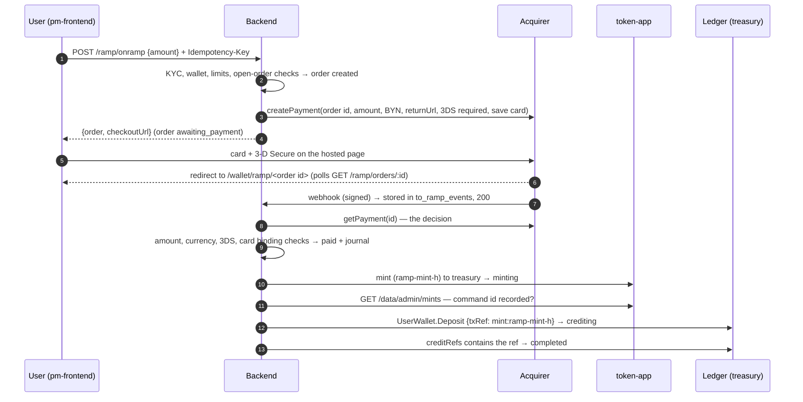
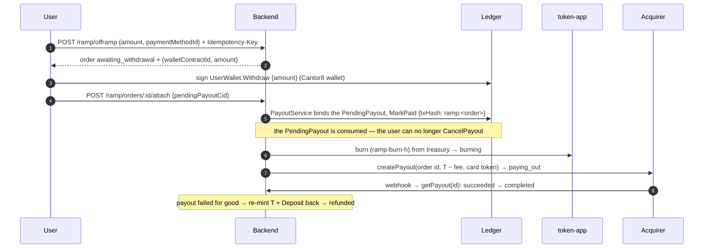

# Fiat ramp — BYN card on-ramp and off-ramp for cBYN

Design and implementation contract for buying cBYN with a bank card and cashing cBYN out to a
card. Written 2026-10-17. The provider-neutral pipeline is built and tested against the mock
provider (`test/ramp.e2e-spec.ts`, 11 scenarios; unit specs for the quote, journal, transition
table, mock signatures and sealing); **the acquiring bank is not chosen yet** (§9 is what we need
from it and the adapter checklist). cBYN mint and burn depend on Cantor8's DevNet token-app
(docs/TOKENS.md §9); `RAMP_ENABLED` stays `false` until both exist.

## 1. What it does

- **On-ramp.** The user pays `F` BYN by card on the acquirer's hosted page. Once the acquirer's
  API confirms the capture, the backend mints `F − fee` cBYN to the treasury through token-app
  and credits the user's in-app cBYN wallet (`UserWallet.Deposit`, the mint-and-credit of
  ARCHITECTURE §8.3).
- **Off-ramp.** The user signs `UserWallet.Withdraw { amount = T }` on the in-app cBYN wallet.
  The backend consumes the `PendingPayout` (`MarkPaid`), burns `T` cBYN from the treasury and
  pays `T − fee` BYN to a card that funded an earlier on-ramp of the same account.
- 1 BYN = 1 cBYN. No FX. Fiat amounts carry 2 decimals (`RAMP_FIAT_DECIMALS`), token amounts
  the usual 10 dp; every amount is a `bigint` in 1e-10 units (ARCHITECTURE §8.4).
- The ramp instrument is the default collateral (cBYN) unless `RAMP_INSTRUMENT` names another.
  On DevNet the stand-in collateral is Canton Coin, so a mock-provider run "sells CC for BYN" —
  meaningless economically, useful for the pipeline.

## 2. Invariants

1. **Reserve ≥ supply at every instant.** Mint only after the funds are captured; burn before
   the funds leave. A failure between steps leaves the reserve over-covered, never short.
2. **The webhook triggers, the provider API decides.** No transition reads a webhook body or a
   redirect parameter; each one re-reads the payment / payout from the provider.
3. **Write-ahead idempotency keys.** Every external side effect has a deterministic key recorded
   on the order by compare-and-set *before* the call: provider payment and payout (order id),
   mint `ramp-mint-<h>`, credit `mint-credit-<h>` (DepositService), `MarkPaid` (PayoutService),
   burn `ramp-burn-<h>`, re-mint `ramp-remint-<h>`; `h = sha256(order id)[:40]`. A crash
   resumes by asking whether the recorded key landed, never by calling again under a new one.
4. **No card data on our servers.** Card entry and 3-D Secure happen on the acquirer's page
   (PCI DSS SAQ A). Stored per card: the provider token (AES-256-GCM sealed with `RAMP_DATA_KEY`),
   the provider fingerprint, brand, last 4, expiry, issuer country. Never the PAN, CVV or name.
5. **Closed loop.** Fiat leaves only to a card that funded a completed, 3DS-authenticated
   on-ramp of the same account. One card fingerprint belongs to one account.
6. **Compare-and-set transitions, audited in the same transaction.** `UPDATE … WHERE status IN
   (<allowed from>)`; the loser of a race never calls upstream. Terminal statuses are final.
7. **Fail closed.** An unreadable provider, token-app or wallet status stops the step and keeps
   the order where it is.

## 3. Flows

### 3.1 On-ramp



### 3.2 Off-ramp



Why `MarkPaid` comes first: `CancelPayout` is user-signed and works while the `PendingPayout`
is live. Burning or paying before consuming it would let a user cancel mid-way and keep both
the balance and the fiat. The off-ramp proceeds only after PayoutService has seen `MarkPaid`
execute (the wallet's command index says the command succeeded), not merely the contract vanish.

The binding: a `withdraw` PendingPayout whose payee account has an off-ramp order in
`awaiting_withdrawal` with the same instrument and the exact amount is bound to that order
(compare-and-set on the order; at most one open off-ramp order per account). `attach` is the
fast path and the payout scan the fallback, and both run the same code under
`lock:payout:<cid>`. A plain withdrawal of the identical amount while an order waits becomes the
cash-out — paid, less the cash-out fee, to the user's own verified card and shown on the order
page; the 15-minute signing window keeps that overlap rare.

### 3.3 Failure paths

| Where | What happens |
|---|---|
| Provider refuses `createPayment` | order `failed`; nothing moved |
| Card declined / 3DS failed / checkout abandoned | `failed` / `expired` after a final provider read |
| Captured, but amount / currency differ, 3DS missing, card bound to another account, card limit, account no longer active | `needs_review`; the operator approves (mint proceeds) or refunds |
| token-app down during mint | stays `minting`; resumes when token-app answers; `RAMP_MAX_ATTEMPTS` → `needs_review` |
| Deposit credit refused by the ledger | DepositService re-arms the row; the order stays `crediting`, attempts exhausted → `needs_review` |
| User cancels the `PendingPayout` before `MarkPaid` | order `cancelled`; nothing burned or paid |
| Burn fails | stays `burning`; nothing paid; `needs_review` after the cap |
| Payout fails for good | `reversing`: re-mint `T` to the treasury, `Deposit` it back (txRef `mint:ramp-remint-h`) → `refunded` |
| Chargeback | order `chargeback`, account suspended (UserService.suspend), journal receivable, Sentry; operator resolves |

## 4. State machine

| Status | Direction | Meaning | Next |
|---|---|---|---|
| `created` | on | row written, payment not yet created | `awaiting_payment`, `failed` |
| `awaiting_payment` | on | checkout open until `expires_at` | `paid`, `needs_review`, `failed`, `expired`, `cancelled`, `chargeback` |
| `paid` | on | captured, journal posted, nothing minted | `minting`, `needs_review`, `refunding`, `chargeback` |
| `minting` | on | `mint_command_id` recorded | `crediting`, `needs_review`, `chargeback` |
| `crediting` | on | mint confirmed; deposit credit written ahead | `completed`, `needs_review`, `chargeback` |
| `awaiting_withdrawal` | off | waiting for the signed `Withdraw` until `expires_at` | `withdrawing`, `expired`, `cancelled` |
| `withdrawing` | off | PendingPayout bound; `MarkPaid` in PayoutService's hands | `burning`, `cancelled`, `needs_review` |
| `burning` | off | `burn_command_id` recorded | `paying_out`, `needs_review` |
| `paying_out` | off | provider payout created (key = order id) | `completed`, `reversing`, `needs_review` |
| `reversing` | off | re-mint + credit back | `refunded`, `needs_review` |
| `needs_review` | both | operator queue; `review_step` names where it stopped | `retry` → that step; `refund`; `fail` |
| `refunding` | on | provider refund requested (only before a mint) | `refunded`, `needs_review` |
| `completed` | both | done | `chargeback` (on) |
| `failed` `expired` `cancelled` | on | closed | `needs_review` only: a capture the acquirer reports after we closed the checkout |
| `refunded` `chargeback` | | terminal | — |

At most one order per account and direction in `created`, `awaiting_payment` or
`awaiting_withdrawal` (partial unique index). The table is `RAMP_TRANSITIONS`
(`ramp-order-store.service.ts`); a move outside it throws before the compare-and-set.

## 5. Data model (migration `1793000000000-Ramp`)

- `to_ramp_orders` — `id`, `user_id` → users, `direction on|off`, `status`, `review_step`,
  `provider`, `instrument_admin/id`, `party_id` (the primary at creation), `fiat_currency`,
  `fiat_amount` (charged on-ramp / paid out off-ramp), `token_amount` (credited / withdrawn),
  `fee_amount` (fiat), `payment_method_id`, `idempotency_key` (unique per user),
  `provider_payment_id` / `provider_payout_id` / `provider_refund_id` (unique per provider),
  `checkout_url`, `expires_at`, `mint_command_id`, `credit_command_id`, `pending_payout_cid`
  (unique), `burn_command_id`, `remint_command_id`, `remint_credit_command_id`, `hold_until`,
  `attempts`, `last_error`, `details jsonb` (3DS result, card snapshot, provider failure code),
  `status_changed_at` (what "stuck" is measured from), `last_polled_at`, `completed_at`, timestamps.
- `to_ramp_events` — the webhook inbox (same lifecycle as `to_kyc_webhook_events`): `provider`,
  unique `event_key`, `kind`, `provider_object_id`, `order_id`, redacted `payload`, `sandbox`,
  `attempts`, `processed_at`, `error`. Payload purged after 30 days with the KYC rows.
- `to_ramp_payment_methods` — `user_id`, `provider`, `fingerprint` (unique per provider),
  `token_sealed`, `brand`, `last4`, `exp_month`, `exp_year`, `issuer_country`,
  `status active|removed|blocked`, `payout_eligible`, `first_order_id`, `last_used_at`.
- `to_ramp_journal` — append-only double entry in fiat: `entry_id`, `order_id`, `account`,
  `currency`, signed `amount` (+ debit, − credit), `memo`. Σ per entry = 0, checked when posting
  and again by the reconciliation.
- `to_payouts.status` gains `blocked_ramp_hold`; `to_payouts.details.offrampOrderId` marks a
  bound PendingPayout.

## 6. Risk and compliance controls

| Control | Rule | Config |
|---|---|---|
| KYC | an approved, unexpired verification at `KYC_REQUIRED_LEVEL` with a person binding, for both directions, whatever `KYC_ENFORCE_WITHDRAWALS` says | `RAMP_REQUIRE_KYC=true` |
| Account | active, primary party set, KYC not `blocked_duplicate` | — |
| Order size | min / max per order | `RAMP_ONRAMP_MIN/MAX`, `RAMP_OFFRAMP_MIN/MAX` |
| Velocity | rolling 24 h and 30 d sums per account and direction (failed / expired / cancelled / refunded do not count) | `RAMP_*_DAILY_MAX`, `RAMP_*_MONTHLY_MAX` |
| Open orders | one per account and direction | DB index |
| 3-D Secure | requested on every payment; a capture without authentication goes to `needs_review` | `RAMP_REQUIRE_3DS=true` |
| Card binding | a fingerprint belongs to one account; at most `RAMP_MAX_CARDS` active cards per account | `RAMP_MAX_CARDS=3` |
| Closed loop | payouts only to an active, payout-eligible card of the account | — |
| Hold | value bought by card cannot leave (off-ramp or plain withdrawal) for `RAMP_HOLD_HOURS` after its credit; a withdrawal past the unlocked balance becomes `blocked_ramp_hold` and settles by itself when the hold ends | `RAMP_HOLD_HOURS=72` |
| Chargeback | account suspended, sessions revoked, all withdrawals blocked, operator queue | — |
| Kill switch | `RAMP_ENABLED=false` refuses new orders; in-flight orders still finish | `RAMP_ENABLED` |

The hold rule: `locked = Σ token_amount of completed on-ramp orders with hold_until > now`;
`unlocked = ledger balance (+ the payout being settled) − locked`.

## 7. Accounting and reconciliation

Journal accounts (BYN): `provider_clearing` (held by the acquirer), `customer_liability` (cBYN
issued through the ramp), `fee_revenue`, `payout_clearing` (cash-outs in flight),
`chargeback_receivable`. Bank settlement (`safeguard_bank`, `provider_fees`) is posted from the
acquirer's settlement report once the adapter exists (§9).

| Event | Debit | Credit |
|---|---|---|
| on-ramp `paid` (F, fee f, net N) | provider_clearing F | customer_liability N, fee_revenue f |
| on-ramp `refunded` | customer_liability N, fee_revenue f | provider_clearing F |
| `chargeback` (F) | chargeback_receivable F | provider_clearing F |
| off-ramp `withdrawing` → `burning` (T, fee f, payout P) | customer_liability T | payout_clearing P, fee_revenue f |
| off-ramp `completed` | payout_clearing P | provider_clearing P |
| off-ramp `refunded` (reversal) | payout_clearing P, fee_revenue f | customer_liability T |

`GET /admin/ramp/reconciliation` runs five checks — `journal_balanced` (every entry sums to
zero), `token_app_matches_orders` (each mint, burn and re-mint the orders call confirmed is
recorded by token-app exactly once), `treasury_covers_in_app_balances` (the index's cBYN
holdings ≥ Σ in-app balances, the TOKENS.md §4.6 float), `journal_liability_non_negative`,
`no_stuck_orders` (nothing in flight unchanged for `RAMP_STUCK_AFTER_MIN`) — and reports the
journal balances next to `orderOutstanding` (Σ on-ramps whose mint is confirmed − Σ cash-outs
whose burn is confirmed). The two liability figures differ by captures not yet minted; a
difference with no order in flight is an incident.

## 8. API (prefix `/api/v1`)

| Method | Path | Auth | Purpose |
|---|---|---|---|
| GET | `/ramp` | session | provider, instrument, fiat, fees, limits with what remains, hold, eligibility reasons |
| POST | `/ramp/quote` | session | `{ direction, amount }` → `{ fiatAmount, tokenAmount, fee }` |
| POST | `/ramp/onramp` | session + `Idempotency-Key` | `{ amount, expectedTokenAmount? }` → `{ order, checkoutUrl }` |
| POST | `/ramp/offramp` | session + `Idempotency-Key` | `{ amount, paymentMethodId, expectedFiatAmount? }` → `{ order, withdraw: { walletContractId, amount } }` |
| POST | `/ramp/orders/:id/attach` | session | `{ pendingPayoutCid }` — binds and settles the signed withdrawal |
| POST | `/ramp/orders/:id/cancel` | session | only `awaiting_payment` / `awaiting_withdrawal` |
| GET | `/ramp/orders` · `/ramp/orders/:id` | session | own orders |
| GET · DELETE | `/ramp/payment-methods` · `/ramp/payment-methods/:id` | session | saved cards (no token on the wire) |
| POST | `/ramp/mock/payments/:paymentId/complete` · `/chargeback` | session; mock provider only | `{ outcome: succeeded \| declined \| no_3ds, cardSeed? }` — produces the signed delivery and runs it through the webhook pipeline |
| POST | `/webhooks/ramp/:provider` | signature | raw body; stored, 200, processed async |
| GET | `/admin/ramp/orders?status=&direction=&userId=` · `/admin/ramp/orders/:id` | admin | queue; order with events, journal, audit trail |
| POST | `/admin/ramp/orders/:id/retry` · `/refund` · `/fail` | admin | `{ reason }`, audited `ramp.admin_action` |
| GET | `/admin/ramp/reconciliation` · `/admin/ramp/provider` | admin | §7 checks; provider health probe |

Errors: `ramp_unavailable` (503: disabled, provider unconfigured, token-app unconfigured),
`ramp_not_eligible` (403, `details.reasons`), `ramp_limit_exceeded` (409, `details.limit`),
`ramp_quote_changed` (409), `ramp_order_open` (409), `ramp_order_state` (409),
`ramp_hold` (409, `details.unlockedAmount`, `details.holdUntil`), plus the existing
`kyc_required`, `no_primary_wallet`, `insufficient_balance`, `not_found`.

## 9. Provider interface and the bank

```ts
interface RampProvider {
  readonly name: RampProviderName;                 // "mock" | <bank adapter>
  readonly capabilities: { cardPayouts: boolean; refunds: boolean };
  isConfigured(): boolean;
  createPayment(i: { orderId; amount; currency; description; returnUrl; notificationUrl;
                     customer: { userId; ip }; expiresAt; require3ds; saveCard }): Promise<{ paymentId; checkoutUrl; expiresAt }>;
  getPayment(paymentId): Promise<RampPayment>;     // status, amount, currency, threeDs, card {token, fingerprint, brand, last4, …}
  refundPayment(paymentId, amount, idempotencyKey): Promise<{ refundId; status }>;
  createPayout(i: { orderId; amount; currency; cardToken; idempotencyKey; notificationUrl }): Promise<{ payoutId; status }>;
  getPayout(payoutId): Promise<RampPayout>;
  verifyWebhook(rawBody: Buffer, headers): RampWebhookEvent | null;   // null = rejected
  healthCheck(): Promise<RampProviderHealth>;
}
```

What the bank / acquirer must offer (the questions for the selection call):

1. Hosted payment page or iframe with 3-D Secure 2 (we stay SAQ A), BYN, Belarusian and
   foreign Visa / Mastercard / Belkart.
2. Card-on-file tokens with a stable card fingerprint.
3. Payouts to cards (Visa Direct / Mastercard Send / Belkart credit) or to the account behind
   the card, with an idempotency key; otherwise bank transfer to an IBAN in the customer's name.
4. Refund API, chargeback notifications, a status API for payments and payouts.
5. Signed webhooks (HMAC or RSA over the raw body, with a timestamp) and an IP list.
6. Daily settlement report (file or API) per transaction: gross, fee, net, settlement date.
7. A sandbox with test cards for every 3DS / decline / chargeback branch.
8. A segregated (safeguarding) account for the cBYN reserve, and the bank's view of the
   platform's licensing for token issuance and exchange in Belarus (legal to confirm).

Belarusian candidates to ask: bePaid, WEBPAY, Assist Belarus (card acquiring with payouts), and
ERIP through the same gateway as a second payment method: pay-by-reference from internet banking,
no card chargebacks, so a shorter hold is defensible.

Adapter checklist: add the name to `RampProviderName` and the `RAMP_PROVIDER` factory; implement
the interface in `ramp-provider-<name>.service.ts` with its config block and boot refusals; map
every provider status to `RampPayment.status` / `RampPayout.status` (unknown → `pending`, never
`succeeded`); unit-test signature vectors, status mapping and amount conversion (minor units);
run every sandbox branch of §3.3 end to end before `RAMP_ENABLED=true`.

## 10. Configuration

```
RAMP_ENABLED=false                 # kill switch for new orders
RAMP_PROVIDER=mock                 # mock (dev/test only; refused in prod and on mainnet) | <bank>
RAMP_INSTRUMENT=                   # <admin>:<id>; blank = the default collateral (cBYN)
RAMP_FIAT_CURRENCY=BYN
RAMP_FIAT_DECIMALS=2
RAMP_PUBLIC_APP_URL=               # the frontend origin for the checkout return page (required)
RAMP_PUBLIC_API_URL=               # the backend's own public base (https://<backend>/api/v1): the acquirer posts to
                                   # <this>/webhooks/ramp/<provider>; the app-host relay forwards only allow-listed headers
RAMP_DATA_KEY=                     # base64 32 bytes, seals card tokens; required unless RAMP_PROVIDER=mock
RAMP_REQUIRE_KYC=true
RAMP_REQUIRE_3DS=true
RAMP_ONRAMP_MIN=10   RAMP_ONRAMP_MAX=2000   RAMP_ONRAMP_DAILY_MAX=3000   RAMP_ONRAMP_MONTHLY_MAX=20000
RAMP_OFFRAMP_MIN=10  RAMP_OFFRAMP_MAX=2000  RAMP_OFFRAMP_DAILY_MAX=3000  RAMP_OFFRAMP_MONTHLY_MAX=20000
RAMP_ONRAMP_FEE_BPS=0   RAMP_ONRAMP_FEE_FIXED=0   RAMP_OFFRAMP_FEE_BPS=0   RAMP_OFFRAMP_FEE_FIXED=0
RAMP_MAX_CARDS=3
RAMP_HOLD_HOURS=72
RAMP_CHECKOUT_TTL_MIN=30           # hosted page lifetime
RAMP_OFFRAMP_SIGN_TTL_MIN=15       # time to sign the Withdraw
RAMP_SCAN_MS=10000                 # processor cadence
RAMP_MAX_ATTEMPTS=5                # per step, then needs_review
RAMP_STUCK_AFTER_MIN=30            # reconciliation flags older non-terminal orders
RAMP_MOCK_WEBHOOK_SECRET=          # mock only; blank = derived from SESSION_SECRET
```

Boot refuses: `RAMP_PROVIDER=mock` with `APP_ENV=prod` or `APP_NETWORK=mainnet`; a real provider
without `RAMP_DATA_KEY` (32 bytes); `RAMP_ENABLED=true` without `RAMP_PUBLIC_APP_URL`; min > max,
daily > monthly, a fee outside 0..5000 bps; `RAMP_INSTRUMENT` that is not `<party>:<id>`.

## 11. Operations

- **`needs_review` queue** (`GET /admin/ramp/orders?status=needs_review`): `review_step` and
  `last_error` say why. `retry` resumes the step (same idempotency keys), `refund` returns the
  card money (on-ramp before a mint) or restores the in-app balance (off-ramp after the burn, when
  the payout failed), `fail` closes an order where no money moved.
- **token-app outage**: on-ramps wait in `paid` / `minting`, off-ramps in `burning`; nothing is
  lost; the processor resumes. Alert on `minting` older than 10 min.
- **Chargeback**: the account is suspended. Recover the value from the in-app balance only with
  the user's signature (UserWallet has no operator debit). A `UserWallet.Clawback` choice
  controlled by the operator with auditors observing is a candidate for the next package.
- **Daily**: `GET /admin/ramp/reconciliation` must be all-green; a red journal or float check
  stops new orders (`RAMP_ENABLED=false`) until explained.

## 12. Open decisions

- Fees and limits: placeholders (0 % fee, 10–2 000 BYN per order, 3 000/day, 20 000/30 days)
  until the bank's pricing and the regulator's thresholds are known.
- Hold length: 72 h for cards; ERIP could go lower.
- Legal: the entity that issues cBYN and runs the exchange in Belarus, and the safeguarding bank,
  decide whether the ramp may serve non-residents and which KYC level applies.
- Whether a card purchase counts for `first_deposit_bonus` (it does not today: `mint:` credits
  are excluded, TOKENS.md §10).
- Questions for Cantor8 (Alex): does token-app dedupe on `command_id` (the resume logic relies on
  "same id never mints twice"), and can token-app burn holdings owned by our treasury, or must the
  treasury transfer to the issuer first (then the burn step becomes transfer + issuer burn)?
